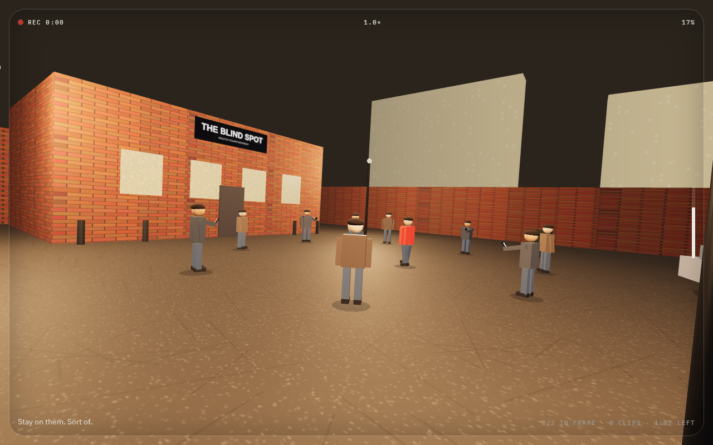
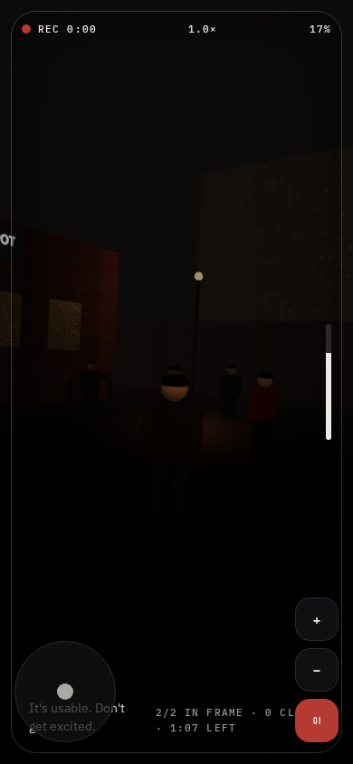
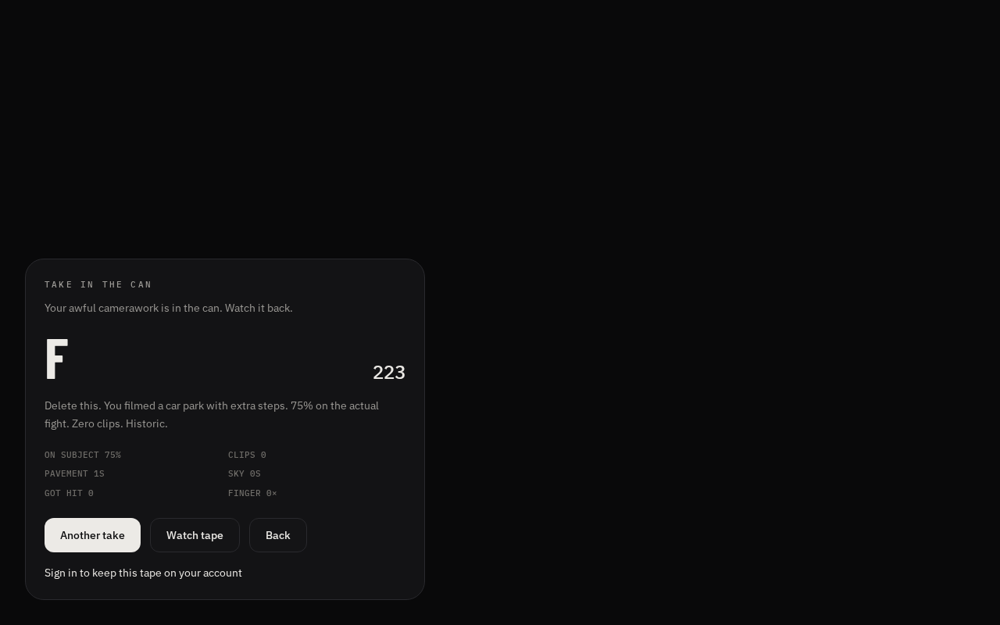

# BAD ANGLE — Fight Filmer Simulator

You are the cameraman. You are not good at this. Keep the scrap in frame,
try not to film the tarmac, and whatever you do — don't get excited.

A small 3D web game where you play a **cameraman filming a fight** rather
than a fighter: move with WASD, aim the phone with the mouse, zoom with
scroll / Q E, and shout. Takes are recorded and can be replayed from your
"tape".

> **Note:** `AGENTS.md` in this repo is the platform's sandbox build
> contract (how the app is generated and previewed in the isolated
> builder). This README is for humans reading the repo directly.

## Stack

- **React 19** + **TanStack Router / Start** (file-based routes, SSR)
- **@react-three/fiber** + **three** for the 3D fight scene
- **Tailwind CSS v4** (via `@tailwindcss/vite`)
- **better-auth** for sign-in / per-user data
- **PGLite** (in-browser Postgres) locally, **Postgres** via `DATABASE_URL`
  on deploy; migrations in `migrations/`
- **Zustand** for the game/tape store

## Run it

```bash
npm install
npm run dev        # vite dev server on http://localhost:8080
```

No `DATABASE_URL` needed locally — the app falls back to PGLite and
applies the same `migrations/` at startup.

## Controls

You play the *cameraman*, not a fighter. Keep the scrap in frame, keep the
tarmac and sky out, and don't panic.

### Desktop

Aiming uses pointer-lock — click the scene once to lock the mouse.

| Action         | Input                                       |
| -------------- | ------------------------------------------- |
| Move           | `W A S D` or the Arrow keys                 |
| Aim / look     | Mouse (click to lock the pointer)           |
| Zoom in / out  | Scroll up / down, or hold `Q` / `E`         |
| Sprint         | Hold `Shift` (faster, but raises the crowd's panic) |
| Shout          | `Space` (raises panic)                      |

### Touch

On a coarse-pointer device, or a window narrower than 700 px, the touch
layout takes over automatically (there is no toggle).

| Action        | Input                                  |
| ------------- | -------------------------------------- |
| Move          | Left virtual stick                     |
| Aim / look    | Drag anywhere on the scene             |
| Zoom in / out | `+` / `−` buttons (bottom-right)       |
| Shout         | `OI` button (bottom-right)             |

There is no sprint on touch.

### See it in action

| | |
| --- | --- |
|  | The take, wide — keep everyone in frame. |
|  | Touch layout: left stick to move, `+`/`−`/`OI` to the right. |
|  | "Take in the can" — the scorecard. |

The scorecard is the whole game in one screen: **ON SUBJECT** (how much of
the take actually shows the fight), **CLIPS**, **PAVEMENT** and **SKY** (how
long you filmed the tarmac or the air), **GOT HIT**, and **FINGER** (how many
times someone's hand crossed the lens). Keep ON SUBJECT high and the rest at
zero.

### What makes a clean take

- **Stay on the subject.** The whole game is "keep the scrap in frame."
- **Don't film the tarmac or the sky.** Panning low or high both hurt the clip.
- **Control your zoom.** Zoom is clamped to a fixed range and drifts back to
  ~1.15× if you leave it alone.
- **Keep it calm.** Sprinting, shouting, getting too close to the fight, or
  getting hit all raise the crowd's *panic* — and a panicked clip is a bad
  clip. The opening line of this README is the entire strategy.

## Scripts

| Command                 | What it does                                    |
| ----------------------- | ----------------------------------------------- |
| `npm run dev`           | Vite dev server (host 0.0.0.0:8080)            |
| `npm run build`         | Vite/Nitro build, then `db:migrate` (skips w/o `DATABASE_URL`) |
| `npm run preview`       | Serve the production build locally             |
| `npm run typecheck`     | `tsc --noEmit`                                 |
| `npm run lint`          | `eslint .`                                     |
| `npm test`              | `node --test` over `scripts/**/*.test.mjs` (zero-dep unit tests) |
| `npm run format`        | `prettier --write .`                           |
| `npm run db:migrate`    | Apply `migrations/` to `DATABASE_URL` (deploy-time) |

## Tests

Unit tests are plain `node --test` (no test framework) and live in
`scripts/*.test.mjs`. They cover the platform head-injection / PWA-chrome
logic (`grok-pwa-shared.mjs`, `grok-pwa-plugin.mjs`), brand/OG-card checks,
and the PWA plugin. The test suite is designed to be hermetic — each test
pins its own working directory so it is not affected by the app's real
`src/lib/og/site.json`.

CI (`.github/workflows/ci.yml`) runs `typecheck`, `lint`, `test` and a
full `build` on every push to `main` and on every PR.

## Performance

The fight scene is a single full-screen R3F canvas; the crowd (a fixed pool
of instanced "people" and spark particles) plus the per-frame camera/zoom
spring are the only things that can hurt frame time. To verify that on real
hardware — the thing you can't do in CI — open the game with **`?perf=1`**
in the URL:

```
http://localhost:8080/?perf=1
```

A green readout appears top-left showing smoothed **fps** and **frame time**
(e.g. `61 fps · 16.4 ms`). It's dev-only, driven by the game loop, and renders
nothing in a normal (non-`?perf=1`) session. The meter math lives in
`src/game/perf.mjs` and is unit-tested in `scripts/perf.test.mjs`.

Use it to measure the crowd/spark draw cost before tuning anything: if a
device tier can't hold ~60 fps, the fix is a device-tier crowd/spark cap
(see issue #7), not dropping the canvas.

## Layout

- `src/routes/` — file-based routes (`index` is the game, `login` is auth,
  `api/` holds server functions).
- `src/game/` — the 3D scene, input, physics sim, audio, and the tape
  (recording/replay) store.
- `src/lib/` — auth, db, OG/share-card helpers, multiplayer.
- `src/components/` — UI (Radix primitives in `ui/`, game overlays in `game/`).
- `server/` — Nitro server functions (auth, `tape` API, PWA middleware).
- `migrations/` — SQL applied to Postgres at deploy / to PGLite at startup.
- `scripts/` — zero-dep test suite + build/deploy helper scripts.
- `public/`, `assets/`, `screenshots/` — static assets and reference shots.
